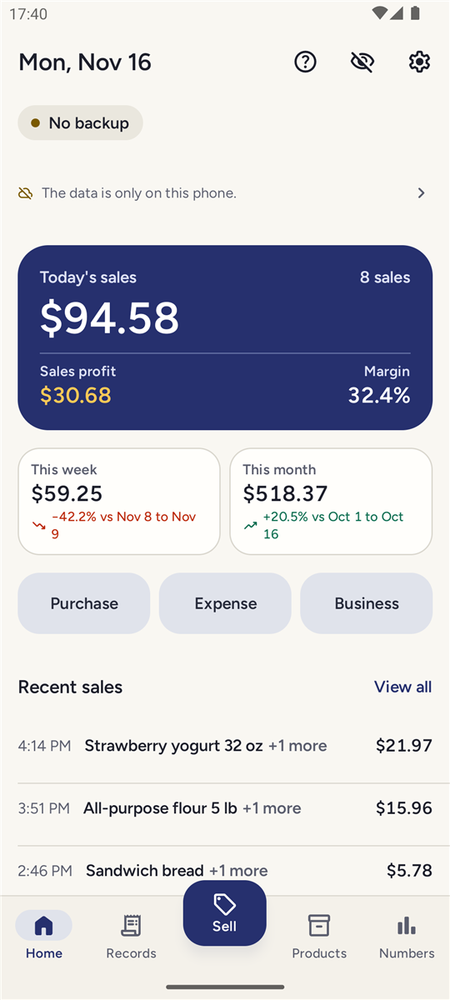
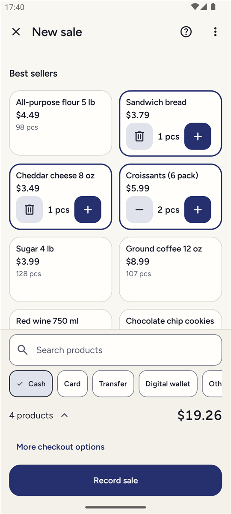

<div align="center">

# Impulsito

**Products, inventory, costs, sales, expenses and profit for a small business, from the phone. Offline, with no servers, and
backed up to the cloud you choose.**


[](LICENSE)
[](https://ko-fi.com/yesidrobayo)

[Español](README.md) · **English** · [Changelog](CHANGELOG.en.md)




</div>

> [!WARNING]
> **Free and open source, no warranty.** Impulsito is made by one person and offered as is. It may have bugs, and nothing replaces
> keeping your backups in order. If you have any problem, open an [issue](https://github.com/Yesid-Robayo/Impulsito/issues) and
> I'll try to help.

> [!IMPORTANT]
> **Impulsito is not accounting software.** It doesn't issue invoices or tax documents, it isn't certified by any authority and it
> doesn't replace any system the law may require of your business. Its receipts are for internal use. Check with whoever advises
> you what applies where you work.

Impulsito is a free Android app for the person who owns a small business and runs it alone: what you have, what each product
costs you, how much you make on each sale and how much you made this month. Everything lives on your phone and works without
internet. There are no servers, no account, no ads, no analytics and no tracking. Your data is backed up to the cloud **you**
choose, and only there.

Nothing about your country is assumed: you pick the currency, its decimals, the date and number format, your taxes and your
payment methods. The app is in Spanish, English and Portuguese.

## Contents

- [Features](#-features)
- [Backups](#-backups)
- [Privacy](#-privacy)
- [Install](#-install)
- [Updates](#-updates)
- [Technology](#-technology)
- [Development](#-development)
- [Reports](#-reports)
- [Credits](#-credits)
- [Support the project](#-support-the-project)
- [License](#-license)

---

## ✨ Features

- **Sell in a few taps:** several payment methods in one sale, payment fees and net received, change, tips, discounts and held sales.
  A sale is never deleted: voiding it leaves a compensating record.
- **Customers and credit:** sales on credit, payments on account, statements, credit balance and loyalty points. Only the name is
  required. Reminders are sent by you, one by one, through the app you choose.
- **Products your way:** units and conversions, services, variants, combos and recipes, photos, your own fields, price lists and
  bulk price updates with margin alerts.
- **Barcode scanner** with the camera or an external reader, and your own codes and labels to print.
- **Inventory as a ledger:** every stock change is a movement that is never edited. Batches and expiry dates, serial numbers,
  locations and transfers, production, suggested reorders and blind counts.
- **Purchases and suppliers:** average and replacement cost, purchases on credit with partial payments and due dates, and returns
  to the supplier.
- **Returns and exchanges** that keep the original cost, so profit and reports stay right.
- **Expenses, recurring expenses and money:** accounts with their balances, withdrawals, contributions and transfers, and cash
  register sessions with a count by denomination.
- **Profit and margin you can trust:** sales profit and final profit for the month, taxes with the rates you type in (included or
  added), and a daily chart. Amounts are stored as whole numbers, never as floating point.
- **Reports:** management summary, projected cash flow, break-even, goals, product and customer analysis, daily summary and
  comparison in real terms.
- **Documents:** sales receipts as PDF or image, quotes, orders and deliveries, and a shareable catalog. They are internal
  documents, never invoices. Printing on paired Bluetooth thermal printers or through the system print service.
- **Import and export:** bring products from CSV or a spreadsheet, and take everything out to CSV or `.xlsx` whenever you want.
- **Backups to the cloud you choose,** with optional encryption and a recovery code. See [Backups](#-backups).
- **Privacy on the phone:** app lock with the phone's fingerprint, face or PIN, a discreet mode that hides amounts, an audit
  log, a screen that shows what data exists and where it goes, and **Delete my data**.
- **Made for daily use:** home screen widget, quick settings tile, shortcuts, tablet layout, a demo with sample data, help inside
  the app, light and dark themes and nine color palettes.
- **Safe updates:** **Check an APK** compares a downloaded file's certificate before you install it, and **Check for update**
  reads a signed version notice. See [Updates](#-updates).

## 💾 Backups

Losing the data is the worst thing that can happen to a business, so this part comes first. You choose one destination:

| Destination | How it saves | What the app promises |
| --- | --- | --- |
| **A WebDAV service** you pick, such as Koofr | Automatically, also with the app closed | Each backup is read back and checked. **All saved** only appears when that check passed |
| **The phone's cloud** (today, Google Drive) | By hand: you tap **Save to Drive** with the app open | The file is handed to Drive. The app never says **All saved** here, because it can't confirm that Drive kept it |

- **The last good backup is never overwritten,** and an empty app never replaces a backup that has data.
- **A second copy on the phone,** and **Export a full backup** to a file you keep on a card or a USB drive.
- **Restoring treats every backup as untrusted,** even one made by the app: it checks size, checksum, structure and data before
  replacing anything, and you can go back to how things were before restoring.
- **Optional encryption,** off by default. When you turn it on, the app shows a recovery code: **without it, nobody can open those
  backups**, so write it down and keep it safe. The format is open, and [`tools/backup-format`](tools/backup-format) has its
  specification and a tool to open a backup on a computer with only the recovery code.
- **My data health** shows when the last backup was saved and checked, and **Test restore** tries a full restore on a separate
  copy, without touching your data.

## 🔒 Privacy

- **No account, no ads, no analytics, no crash reporting and no tracking.** The app works fully offline.
- **It only connects to two places:** the WebDAV service you choose, and, only when you tap **Check for update**, the signed version
  notice at `https://yesid-robayo.github.io/Impulsito/version.json`. That check sends no data: the host only sees your IP address,
  as with any web request.
- **Permissions only when needed:** the camera when you scan or take a photo, and Bluetooth only for paired printers. The app
  doesn't read your contacts: you pick one with the system picker.
- Read the [privacy policy](https://yesid-robayo.github.io/Impulsito/#privacy) and the
  [terms of use](https://yesid-robayo.github.io/Impulsito/#terms).

## 📦 Install

Impulsito isn't in any app store. The only official place to get it is this repository's
[Releases](https://github.com/Yesid-Robayo/Impulsito/releases).

1. Download `impulsito-1.0.0.apk` from the release.
2. **Check it before installing.** On a computer with the Android SDK build tools, compare its SHA-256 with the one in the release
   notes, and its signing certificate with the fingerprint below. In PowerShell:

   ```powershell
   $bt = (Get-ChildItem "$env:ANDROID_HOME\build-tools" | Sort-Object Name | Select-Object -Last 1).FullName
   & "$bt\apksigner.bat" verify --print-certs --verbose -Werr .\impulsito-1.0.0.apk
   Get-FileHash -Algorithm SHA256 .\impulsito-1.0.0.apk
   ```

   On Linux or macOS, `apksigner verify --print-certs impulsito-1.0.0.apk` and `sha256sum impulsito-1.0.0.apk` do the same.

   The line `Signer #1 certificate SHA-256 digest` must show the release certificate, with or without colons:

   ```text
   7C:E8:28:E9:BB:AC:03:6A:19:CA:E6:ED:16:DD:FD:16:AE:C9:D2:6E:12:BA:96:75:50:54:C0:49:6E:42:CC:21
   7ce828e9bbac036a19cae6ed16ddfd16aec9d26e12ba96755054c0496e42cc21
   ```

   If it doesn't match, **don't install it**.
3. Open the APK on the phone. Android asks you to allow installing unknown apps **for the app you opened it from** (your browser or
   your files app). Allow it, install, and then you can take that permission away again.

Impulsito needs Android 8.0 or newer. Inside the app, **Updates and APK check** shows the certificate fingerprint too.

## 🔄 Updates

**The app never downloads or installs anything by itself:** only when you ask.

1. Make a backup and check that it's recent.
2. **Check for update** tells you whether there is a new version. It's optional and only runs when you tap it.
3. From `1.0.2`, tap **Update**: the app downloads that version from [Releases](https://github.com/Yesid-Robayo/Impulsito/releases),
   checks it's the file announced in the signed notice and carries the app's signature, and Android asks you to confirm. The first
   time, Android also asks to allow Impulsito to install its updates.
4. You can also download the APK by hand and use **Check an APK** before installing it **over** the current app. **Never uninstall
   to update:** uninstalling deletes everything that isn't backed up.

If Android refuses an update because the signature is different, the file isn't the official one: don't force it.

## 🔧 Technology

- **Kotlin** 2.4 and **Jetpack Compose** (BOM 2026.09.00) with Material 3, Navigation 3 and the adaptive layout for tablets.
- **Room** 3 with its own **bundled SQLite**, so the database behaves the same on every phone.
- **WorkManager** for automatic backups, **OkHttp** 5 only for WebDAV and the version notice, and **Tink** 1.24 for the optional
  backup encryption.
- **CameraX** and **zxing-cpp** for the scanner, **Vico** for the charts and **Glance** for the widget.
- Three modules: `domain` (business rules, plain Kotlin), `data` (database, backups and network) and `app` (screens).

The exact versions are in [`gradle/libs.versions.toml`](gradle/libs.versions.toml).

## 💻 Development

Requirements: [Android Studio](https://developer.android.com/studio) with its bundled JetBrains Runtime (JDK 25), and the Android SDK
with the API 37 platform and the build tools.

```powershell
git config core.hooksPath tools/git-hooks   # once per clone
.\gradlew.bat :domain:test                  # business rules, no device needed
.\gradlew.bat check                         # lint, tests and code rules
.\gradlew.bat assembleDebug                 # debug APK, installs next to the real app
```

On Linux or macOS, use `./gradlew` instead of `.\gradlew.bat`.

- **The git hooks** reject commits with real email addresses, ask for commit times in UTC (`TZ=UTC0`) and run
  [gitleaks](https://github.com/gitleaks/gitleaks), which has to be installed.
- **Release signing** needs a local `keystore.properties` with `storeFile` and `keyAlias`, and the password in the
  `RELEASE_KEYSTORE_PASSWORD` environment variable, building with `--no-configuration-cache`. Neither the keystore nor its password
  is ever committed. Without them, `debug` builds on any computer and `release` comes out unsigned.
- An APK you build yourself is signed with a different key, so it can't update the official app, and the official app can't update
  it.

## 🐞 Reports

- **Pull requests are not accepted** (they are closed automatically). The code is changed only by whoever maintains the app.
- **Issues are for bugs, questions and ideas.** See [CONTRIBUTING.md](CONTRIBUTING.md).
- **Never attach backups, databases, CSV files or screenshots with real data** from a business or its customers. Use made-up data.
- **A security problem doesn't go in an issue:** report it privately, as [SECURITY.md](SECURITY.md) explains.
- It's made by one person: there's no support commitment, and issues get an answer when there's time.

## 🙏 Credits

- The libraries listed in [Technology](#-technology), the **Figtree** and **Noto Sans** fonts and the **Material Symbols** icons.
  Their licenses are in [THIRD_PARTY_NOTICES.txt](THIRD_PARTY_NOTICES.txt) and in the app, under **Licenses**.
- **Impulsito is an independent project,** not affiliated with or endorsed by Google, Koofr or any other company. Their names only say
  which services it works with, and belong to their owners.

---

## ☕ Support the project

Impulsito is free and made by one person. If it's useful to you and you want to support it, you can buy me a coffee on
**[Ko-fi](https://ko-fi.com/yesidrobayo)**. It's not required: a clear bug report helps a lot too.

---

## 📄 License

- Impulsito is licensed under the **[MIT License](LICENSE)**. It's provided **as is, without any warranty**. You can use, copy,
  modify and redistribute the code.
- **The license doesn't cover the name.** Only the signed APK published in this repository's Releases is the official app.
- The fonts keep their own license, the SIL Open Font License 1.1, and the other components keep theirs: see
  [THIRD_PARTY_NOTICES.txt](THIRD_PARTY_NOTICES.txt).
