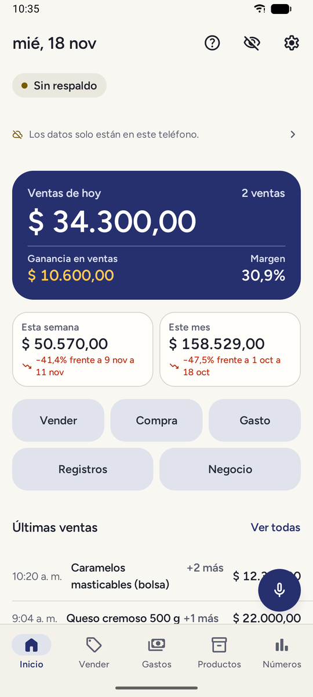
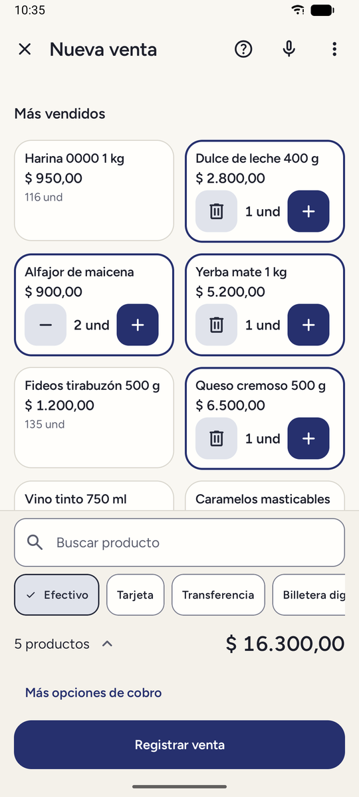

<div align="center">

# Impulsito

**Productos, stock, costos, ventas, gastos y ganancias de un emprendimiento, desde el celular. Sin internet, sin servidores y con
respaldo en la nube que tú elijas.**


[](LICENSE)
[](https://ko-fi.com/yesidrobayo)

[English](README.md) · **Español** · [Cambios por versión](CHANGELOG.es.md)




</div>

> [!WARNING]
> **Gratis y de código abierto, sin garantía.** Impulsito lo hace una sola persona y se ofrece tal cual. Puede tener errores, y nada
> reemplaza tener tus copias al día. Si tienes algún problema, abre un [*issue*](https://github.com/Yesid-Robayo/Impulsito/issues) y
> trato de ayudarte.

> [!IMPORTANT]
> **Impulsito no es un programa de contabilidad.** No emite facturas ni documentos tributarios, no está certificado por ninguna
> autoridad y no reemplaza ningún sistema que la ley le exija a tu negocio. Sus comprobantes son de uso interno. Confirma con quien te
> asesora qué se aplica donde trabajas.

Impulsito es una app Android gratuita para la persona dueña de un emprendimiento que lo lleva sola: qué tiene, cuánto le cuesta cada
producto, cuánto gana en cada venta y cuánto ganó este mes. Todo vive en tu celular y funciona sin internet. No hay servidores, ni
cuenta, ni anuncios, ni analítica, ni rastreo. Tus datos se respaldan en la nube que **tú** elijas, y solo ahí.

No se asume nada de tu país: eliges la moneda, sus decimales, el formato de fechas y números, tus impuestos y tus métodos de pago. La
app está en español, inglés y portugués.

## Contenido

- [Funciones](#-funciones)
- [Copias de seguridad](#-copias-de-seguridad)
- [Privacidad](#-privacidad)
- [Instalar](#-instalar)
- [Actualizar](#-actualizar)
- [Tecnología](#-tecnología)
- [Desarrollo](#-desarrollo)
- [Reportes](#-reportes)
- [Créditos](#-créditos)
- [Apoya el proyecto](#-apoya-el-proyecto)
- [Licencia](#-licencia)

---

## ✨ Funciones

- **Vende en pocos toques:** varios métodos de pago en una venta, comisiones y neto recibido, cambio, propinas, descuentos y ventas
  en espera. Una venta nunca se borra: anularla deja un registro compensatorio.
- **Clientes y crédito:** ventas a crédito, abonos, extractos, saldo a favor y puntos. Solo se pide el nombre. Los recordatorios los
  envías tú, uno por uno, con la app que elijas.
- **Productos a tu manera:** unidades y conversiones, servicios, variantes, combos y recetas, fotos, campos propios, listas de
  precios y actualización masiva de precios con alertas de margen.
- **Escáner de códigos** con la cámara o con un lector externo, y códigos y etiquetas propios para imprimir.
- **El stock es un libro:** cada cambio es un movimiento que nunca se edita. Lotes y vencimientos, números de serie, ubicaciones y
  transferencias, producción, reposición sugerida y conteo a ciegas.
- **Compras y proveedores:** costo promedio y de reposición, compras a plazo con pagos parciales y vencimientos, y devoluciones al
  proveedor.
- **Devoluciones y cambios de producto** que conservan el costo original, para que la ganancia y los reportes sigan bien.
- **Gastos, gastos recurrentes y dinero:** cuentas con su saldo, retiros, aportes y transferencias, y sesiones de caja con conteo por
  denominación.
- **Ganancia y margen confiables:** ganancia en ventas y ganancia final del mes, impuestos con las tasas que tú escribes (incluidos o
  añadidos) y una gráfica por día. Los montos se guardan como números enteros, nunca con decimales flotantes.
- **Reportes:** resumen de gestión, flujo de caja proyectado, punto de equilibrio, metas, análisis de productos y clientes, resumen
  diario y comparación en términos reales.
- **Documentos:** comprobantes de venta en PDF o imagen, cotizaciones, pedidos y entregas, y un catálogo para compartir. Son
  documentos internos, nunca facturas. Impresión en impresoras térmicas Bluetooth emparejadas o con el servicio de impresión del
  sistema.
- **Importar y exportar:** trae productos desde CSV o una hoja de cálculo, y saca todo a CSV o `.xlsx` cuando quieras.
- **Copias en la nube que elijas,** con cifrado opcional y un código de recuperación. Mira [Copias de seguridad](#-copias-de-seguridad).
- **Privacidad en el celular:** bloqueo con la huella, el rostro o el PIN del teléfono, un modo discreto que oculta los montos, un
  registro de auditoría, una pantalla que muestra qué datos hay y adónde van, y **Borrar mis datos**.
- **Hecha para el día a día:** widget en la pantalla de inicio, mosaico de ajustes rápidos, atajos, diseño para tableta, una
  demostración con datos de ejemplo, ayuda dentro de la app, tema claro y oscuro y nueve paletas de colores.
- **Actualizaciones seguras:** **Verificar un APK** compara el certificado de un archivo descargado antes de instalarlo, y **Buscar
  actualización** lee un aviso de versión firmado. Mira [Actualizar](#-actualizar).

## 💾 Copias de seguridad

Perder los datos es lo peor que le puede pasar a un negocio, así que esto va primero. Eliges un destino:

| Destino | Cómo guarda | Lo que promete la app |
| --- | --- | --- |
| **Un servicio WebDAV** que elijas, como Koofr | Solo, también con la app cerrada | Cada copia se vuelve a leer y se comprueba. **Todo guardado** solo aparece cuando esa comprobación pasó |
| **La nube del teléfono** (hoy, Google Drive) | A mano: tocas **Guardar en Drive** con la app abierta | El archivo se entrega a Drive. Aquí la app nunca dice **Todo guardado**, porque no puede confirmar que Drive lo conservó |

- **Nunca se sobrescribe la última copia buena,** y una app vacía nunca reemplaza una copia con datos.
- **Una segunda copia en el celular,** y **Exportar una copia completa** a un archivo que guardas en una tarjeta o una memoria USB.
- **Restaurar trata toda copia como no confiable,** aunque la haya hecho la app: comprueba tamaño, suma, estructura y datos antes de
  reemplazar nada, y puedes volver a como estaba todo antes de restaurar.
- **Cifrado opcional,** apagado por defecto. Al activarlo, la app te muestra un código de recuperación: **sin él, nadie puede abrir
  esas copias**, así que anótalo y guárdalo bien. El formato es abierto, y [`tools/backup-format`](tools/backup-format) tiene su
  especificación y una herramienta para abrir una copia en un computador solo con el código de recuperación.
- **Salud de mis datos** muestra cuándo se guardó y se comprobó la última copia, y **Probar restauración** prueba una restauración
  completa sobre una copia aparte, sin tocar tus datos.

## 🔒 Privacidad

- **Sin cuenta, sin anuncios, sin analítica, sin reportes de fallos y sin rastreo.** La app funciona completa sin internet.
- **Solo se conecta a dos lugares:** el servicio WebDAV que elijas y, solo cuando tocas **Buscar actualización**, el aviso de versión
  firmado en `https://yesid-robayo.github.io/Impulsito/version.json`. Esa consulta no envía ningún dato: el servidor solo ve tu
  dirección IP, como en cualquier petición web.
- **Permisos solo cuando hacen falta:** la cámara al escanear o tomar una foto, y Bluetooth solo para impresoras emparejadas. La app
  no lee tus contactos: eliges uno con el selector del sistema.
- Lee la [política de privacidad](https://yesid-robayo.github.io/Impulsito/#privacy) y los
  [términos de uso](https://yesid-robayo.github.io/Impulsito/#terms).

## 📦 Instalar

Impulsito no está en ninguna tienda de aplicaciones. El único lugar oficial para obtenerla son los
[Releases](https://github.com/Yesid-Robayo/Impulsito/releases) de este repositorio.

1. Descarga `impulsito-1.0.0.apk` del release.
2. **Compruébalo antes de instalar.** En un computador con las herramientas de compilación del SDK de Android, compara su SHA-256 con
   el de las notas del release, y su certificado de firma con la huella de abajo. En PowerShell:

   ```powershell
   $bt = (Get-ChildItem "$env:ANDROID_HOME\build-tools" | Sort-Object Name | Select-Object -Last 1).FullName
   & "$bt\apksigner.bat" verify --print-certs --verbose -Werr .\impulsito-1.0.0.apk
   Get-FileHash -Algorithm SHA256 .\impulsito-1.0.0.apk
   ```

   En Linux o macOS, `apksigner verify --print-certs impulsito-1.0.0.apk` y `sha256sum impulsito-1.0.0.apk` hacen lo mismo.

   La línea `Signer #1 certificate SHA-256 digest` debe mostrar el certificado de release, con o sin dos puntos:

   ```text
   7C:E8:28:E9:BB:AC:03:6A:19:CA:E6:ED:16:DD:FD:16:AE:C9:D2:6E:12:BA:96:75:50:54:C0:49:6E:42:CC:21
   7ce828e9bbac036a19cae6ed16ddfd16aec9d26e12ba96755054c0496e42cc21
   ```

   Si no coincide, **no lo instales**.
3. Abre el APK en el celular. Android te pide permitir instalar apps desconocidas **para la app desde la que lo abriste** (el navegador
   o tu app de archivos). Acéptalo, instala y luego puedes quitarle ese permiso.

Impulsito necesita Android 8.0 o superior. Dentro de la app, **Actualizaciones y verificación de APK** también muestra la huella del
certificado.

## 🔄 Actualizar

Las actualizaciones son a mano, y **la app nunca descarga ni instala nada por su cuenta.**

1. Haz una copia y comprueba que sea reciente.
2. **Buscar actualización** te dice si hay una versión nueva. Es opcional y solo se ejecuta cuando la tocas.
3. Descarga el APK nuevo de [Releases](https://github.com/Yesid-Robayo/Impulsito/releases) y usa **Verificar un APK** en la app:
   compara el certificado del archivo con el de la app instalada antes de abrir el instalador.
4. Instálalo **encima** de la app actual. **Nunca desinstales para actualizar:** desinstalar borra todo lo que no tenga copia.

Si Android rechaza una actualización porque la firma es distinta, el archivo no es el oficial: no la fuerces.

## 🔧 Tecnología

- **Kotlin** 2.4 y **Jetpack Compose** (BOM 2026.09.00) con Material 3, Navigation 3 y el diseño adaptable para tabletas.
- **Room** 3 con su propio **SQLite empaquetado**, para que la base se comporte igual en todos los celulares.
- **WorkManager** para las copias automáticas, **OkHttp** 5 solo para WebDAV y el aviso de versión, y **Tink** 1.24 para el cifrado
  opcional de las copias.
- **CameraX** y **zxing-cpp** para el escáner, **Vico** para las gráficas y **Glance** para el widget.
- Tres módulos: `domain` (reglas del negocio, Kotlin puro), `data` (base, copias y red) y `app` (pantallas).

Las versiones exactas están en [`gradle/libs.versions.toml`](gradle/libs.versions.toml).

## 💻 Desarrollo

Requisitos: [Android Studio](https://developer.android.com/studio) con el JetBrains Runtime que trae (JDK 25), y el SDK de Android con
la plataforma de la API 37 y las herramientas de compilación.

```powershell
git config core.hooksPath tools/git-hooks   # una vez por clon
.\gradlew.bat :domain:test                  # reglas del negocio, sin dispositivo
.\gradlew.bat check                         # lint, pruebas y reglas del código
.\gradlew.bat assembleDebug                 # APK de depuración, se instala junto a la app real
```

En Linux o macOS, usa `./gradlew` en lugar de `.\gradlew.bat`.

- **Los ganchos de Git** rechazan commits con correos reales, piden la hora del commit en UTC (`TZ=UTC0`) y ejecutan
  [gitleaks](https://github.com/gitleaks/gitleaks), que debe estar instalado.
- **La firma de release** necesita un `keystore.properties` local con `storeFile` y `keyAlias`, y la contraseña en la variable de
  entorno `RELEASE_KEYSTORE_PASSWORD`, compilando con `--no-configuration-cache`. Ni el keystore ni su contraseña entran nunca en un
  commit. Sin ellos, `debug` compila en cualquier computador y `release` sale sin firmar.
- Un APK que compiles tú va firmado con otra clave, así que no puede actualizar la app oficial, ni la oficial a él.

## 🐞 Reportes

- **No se aceptan *pull requests*** (se cierran automáticamente). El código solo lo cambia quien mantiene la app.
- **Los *issues* son para errores, dudas e ideas.** Mira [CONTRIBUTING.md](CONTRIBUTING.md).
- **Nunca adjuntes copias, bases, archivos CSV ni capturas con datos reales** de un negocio o de sus clientes. Usa datos inventados.
- **Un problema de seguridad no va en un *issue*:** avísalo en privado, como explica [SECURITY.md](SECURITY.md).
- Lo hace una sola persona: no hay compromiso de soporte, y los *issues* se responden cuando hay tiempo.

## 🙏 Créditos

- Las bibliotecas de [Tecnología](#-tecnología), las fuentes **Figtree** y **Noto Sans** y los iconos **Material Symbols**. Sus
  licencias están en [THIRD_PARTY_NOTICES.txt](THIRD_PARTY_NOTICES.txt) y en la app, en **Licencias**.
- **Impulsito es un proyecto independiente,** sin relación con Google, Koofr ni ninguna otra empresa, ni respaldado por ellas. Sus
  nombres solo indican con qué servicios funciona, y pertenecen a sus dueños.

---

## ☕ Apoya el proyecto

Impulsito es gratis y lo hace una sola persona. Si te sirve y quieres apoyarlo, puedes invitarme a un café en
**[Ko-fi](https://ko-fi.com/yesidrobayo)**. No es obligatorio: un buen reporte de un error también ayuda mucho.

---

## 📄 Licencia

- Impulsito tiene licencia **[MIT](LICENSE)**. Se ofrece **tal cual, sin ninguna garantía**. Puedes usar, copiar, modificar y
  redistribuir el código.
- **La licencia no cubre el nombre.** Solo el APK firmado que se publica en los Releases de este repositorio es la app oficial.
- Las fuentes conservan su propia licencia, la SIL Open Font License 1.1, y los demás componentes la suya: mira
  [THIRD_PARTY_NOTICES.txt](THIRD_PARTY_NOTICES.txt).
